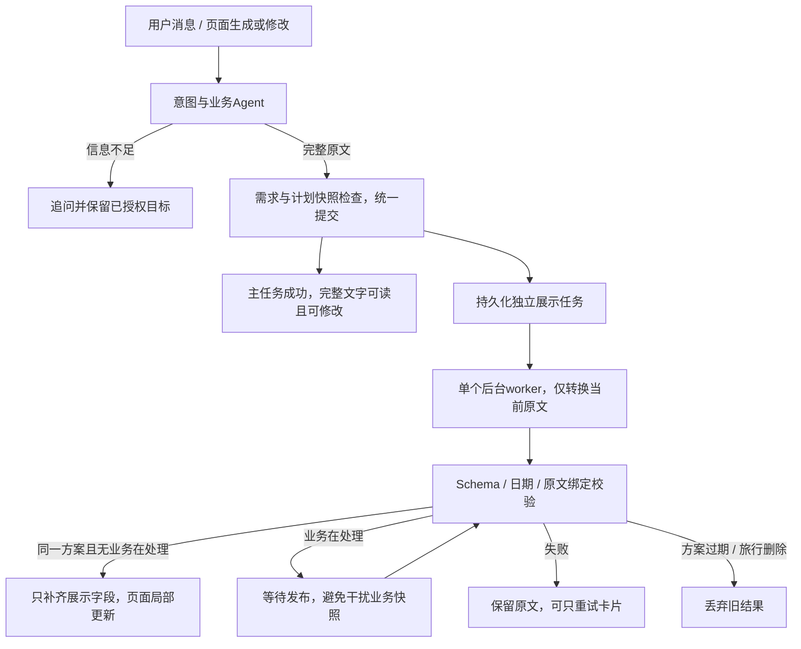

# 当前架构：四意图、文字先交付与后台卡片

2026-10-11。意图识别和闲聊为无工具LLM节点；查询、规划、修改共用Agent Loop。每趟旅行只保留一份当前行程。规划/修改原文先保存，主任务完成后独立展示任务整理卡片。

所有聊天处理节点都接收当前已保存需求及备注；意图识别和闲聊同时接收实际缺项列表，近期对话保持8条。询问已保存需求由无工具闲聊回答，已保存状态优先于旧聊天值；可选偏好不阻塞回复。新旅程欢迎消息确认实际保存的信息，缺项判断与规划共用，不再使用固定补充清单。详见[角色与上下文](agent-role-implementation.md)。

## 业务权限与保存

查询只读，解释不改行程。规划只补充需求时不生成；生成前审阅最新原话并检查五组必填。页面生成直接使用已保存需求。生成和修改返回完整原文后进入统一保存边界；独立模型交付复核已按用户要求删除，不再由第二个模型的语义意见阻止保存或触发改写。

生成时，对唯一名称匹配的抵达点、必去核心点和离开点，程序检查当前轮是否尝试过对应方向的接驳；允许一次遗漏补查，仍遗漏则不保存。未匹配/重名不强配，已有失败尝试不自动重试。此检查只证明已尝试查询，不验证模型是否正确使用返回结果。

业务回复通过 `_commit_agent_result()`核对需求revision、计划ID及完整快照，再保存原文、计划需求快照和实际工具证据。需要补充、失败或旧轮作废的结果不覆盖当前方案。

2026-10-13补充：planning/update_and_query只在用户明确要求更新需求并查询资料时使用，在同一循环里先同步、再查询，不生成行程。五组必填工具字段有明确格式说明，Schema字段顺序固定；首次部分提取允许一次重新审阅，最终仍缺项时追问，禁止保存草案。正常追问的任务记录needs_input=true并完成处理，保留待生成目标，不标为处理失败。

明确文字修改优先使用edit_plan_text：模型提供完整原话、操作、原文目标和用户指定的新文字，程序做精确追加或唯一匹配替换。重复片段通过唯一原文上下文定位；新文字必须逐字来自当前用户消息。操作完成即结束循环，保留其他原文和证据，不重写整篇。开放式修改继续使用原流程。

聊天确认仍由程序绑定当前快照；确认只改变状态，不证明事实已核实。历史列表、历史保存对象与恢复接口已移除。下一阶段的产品范围、默认地铁策略与移除确认等以[产品边界](product-boundaries-v1.md)为准。

## 高德MCP查询

2026-10-13接入官方Streamable HTTP服务。应用仍向业务Agent提供search_places、search_food、query_route；后端适配MCP的maps_text_search、maps_search_detail及步行/驾车/公交规划。模型不接触Key，也不能直接调用MCP其他导航/打车工具。

POI搜索最多5个详情补齐可信坐标；详情ID与搜索ID不一致或坐标无效时不进入可信目录。餐厅按本次已获取详情且有评分的候选排序，缺失字段保持未知，不保证全城排名。路线使用已有可信POI目录和缓存，结果保留查询时估算/未知边界。

一个应用工具共享默认20秒（连接/初始化/发现/最多6次MCP工具调用），每个额外详情调用计入主业务外部查询预算。握手/工具发现作为连接开销，不当成一次旅行事实查询；模型轮次、应用工具次数与MCP实际请求数分别记录。Key日志脱敏，MCP失败不直连REST重试。天气继续Open-Meteo。具体验证见[实施记录](amap-mcp-implementation.md)。

初始化、工具发现及工具执行各自记录安全阶段诊断。搜索前按最多6次外部调用检查剩余预算，不足时明确返回budget_exhausted，模型用已有依据保留未知；真正的取消/超时/预算异常仍不吞掉。同一业务循环中，完全相同参数的成功地点、餐厅、天气结果可复用，失败结果和跨轮结果不复用；权限和取消检查仍先执行。

## 独立展示任务

`app/display_tasks.py`在Store中管理 `display_jobs`。业务任务只有chat/plan/revision，展示任务不进入该列表，也不使规划/修改按钮持续锁定。只有当前方案的展示记录被保留；替换原文或删除旅行会移除旧记录，使迟到回调不能回写。

前台生成的原文设置display_status=pending、display=None。worker使用计划需求快照中的日期和原文hash，默认独立180秒预算，不运行业务Loop、不查询旅行工具。转换使用按保存日期动态限定天数与日期范围的Schema，本地继续检查日期顺序与数量。结构/解析/日期错误允许一次纠错，剩余不足60秒、两次请求预算已耗尽或有前台业务时不追加；网络或超时错误不自动重试。纠错继续以原文为唯一依据，缺失日保持空活动并明确说明，不编造或复制安排。

默认模型输出格式为YAML块文本，规避本次实测约束JSON解码器在引号前截断字符串的问题；保存与API仍使用JSON Schema 1.1的数据结构。YAML解析拒绝别名、显式标签、重复键和多文档，日期保留字符串；解析后严格校验所有字段，包括weather。TRAVEL_DISPLAY_OUTPUT_FORMAT=json可使用JSON Schema请求，供已验证能正确处理引号的服务使用；两种格式不自动互相降级。

同一旅行的queued/running业务或直接Store生成/修改运行期间，后台不改TripPlan展示字段，已完成的结果在独立记录中等待发布。业务结束后重新核对绑定，挂载只更新display、display_source_hash、display_status，保留当前原文、证据、依据、计划ID与确认状态。

worker并发为1，有业务请求时不发出新的后台转换。运行中的远端请求不能保证立即停止，作废保护阻止结果写入。清空聊天取消未完成展示但保留原文；服务停止/重启标记中断，保留原文并提供显式重试，不自动重跑。

`TRAVEL_DISPLAY_ENABLED=0`关闭新的后台转换。已有ready展示保留，文字仍可交付。单位测试默认关闭自动worker，显式drain用于确定性验证；生产与浏览器夹具自动运行。

## 页面与接口

- `GET /api/trips/{id}/plan-state`：当前计划ID、原文hash、展示状态与版本；登录/所有权保护。
- `GET /workspace/{id}/display/partial`：仅当前计划绑定匹配时返回卡片片段，旧绑定409。
- `POST /api/trips/{id}/display`：绑定当前原文的卡片重试，去重，不重新规划、不新增业务消息。

生成/修改主任务结束即进入原文页面。pending时提示正在整理卡片，后台完成只替换卡片容器，保留原文展开、输入草稿、选择范围与阅读位置。片段绑定不匹配或DOM已更换则丢弃。转换失败保留文字与重试入口。

业务活跃时前端轮询1秒，空闲聊天3秒、任务2.5秒；后台卡片每2秒检查，完成停止、隐藏页面暂停。当前实现未引入SSE和流式首token。

## 持久化与测量

SQLite快照schema_version=5，保存当前计划、业务任务和独立展示记录。升级旧快照前以SQLite backup创建备份；恢复时缺失展示记录按空集合处理，中断pending转换回退原文，旧ready展示继续保留。

恢复数据不再依据固定文案删除/改写想法卡片，也不合并同名卡片；旧群聊迁移保留原文，不做称谓替换。明确标记为展示1.0的已保存卡片在读取时迁移为1.1并补weather=[]，副本迁移不改输入。新版模型响应始终严格校验，缺weather不能通过兼容处理补空。

测量器区分foreground、display和观测等待，Chrome/Perfetto有独立轨道。每条轨道的自身耗时可加和，不同轨道的重叠不能相加为用户等待；前台文字响应与后台最终完成分别报告。

校验仍不证明原文逐句事实、完整时间可执行性或展示语义忠实度。相关回归与固定原文对照继续保留，见[优化方案](agent-latency-optimization-proposal.md)和[耗时测试集](../tests/datasets/agent_latency_v1/README.md)。
