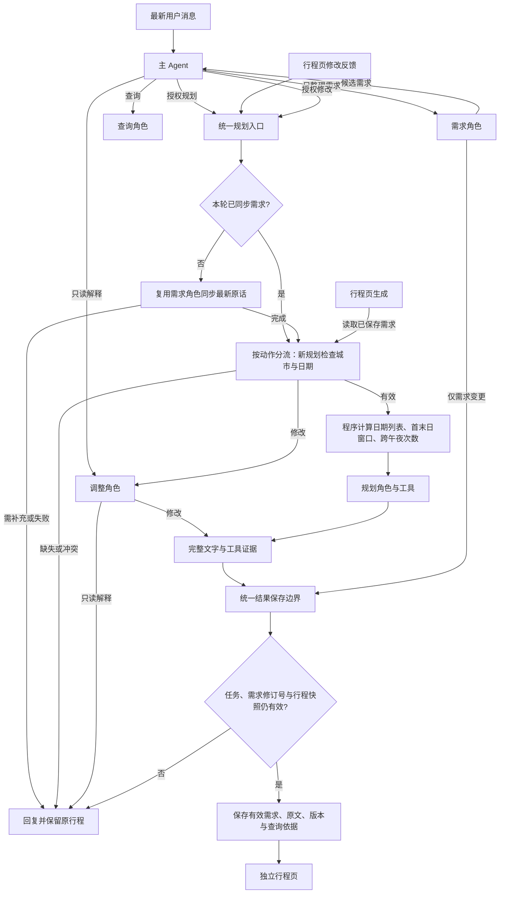

# 当前 Agent 架构：入口、证据与统一保存

2026-10-08。保留一个主Agent、需求/查询/规划/调整四个业务角色和通用Loop，模型为gpt-5.6-sol（Responses）。本次重构业务流程中的必经步骤和保存边界，不增加意图分类器、结构化行程转换或独立审查角色。

## 模块职责

| 模块 | 职责 |
| --- | --- |
| agent_roles.py及角色提示词 | 角色权限、业务规则、思考档位 |
| planning.py | 仅依据有效需求检查规划前置条件、计算日期与跨午夜次数 |
| agent_runtime.py | 前置需求同步、共用角色Loop、工具执行与证据收集、共享预算 |
| agent_client.py及model_transport.py | 模型调用、Responses/Chat协议转换、异常与日志 |
| store.py::_commit_agent_result | 聊天、生成和修改共用最终写入检查与提交路径 |
| models.py及persistence.py | 文字、查询依据、需求依据修订号及历史版本的保存/恢复 |
| tasks.py | 请求去重、排队/执行状态、新消息替代与迟到结果丢弃 |

主Agent负责决定用户授权了哪类业务；一旦进入行程写入，框架保证本轮需求同步经过/复用，新规划再检查日期。只读解释不经过写入前置流程。需求角色仍负责自然语言理解，框架不声称能证明其提取完整或语义正确。

## 入口行为

聊天进入规划/修改，或行程页提交修改反馈时，本轮尚未整理需求则先由现有需求角色处理最新用户原话；主Agent已经显式整理过需求则复用结果。局部备注或活动时间不应改写全局需求，未改变全局要求时返回空变更。前置阶段仍计入原有模型次数和时间预算。该步骤由框架触发，业务子Agent不获得递归委派工具。

独立行程页的生成入口只读取已保存有效需求，不把旧聊天恢复为已撤销硬约束。城市或具体起止日期缺失时直接提问，不发出规划模型请求或外部查询。人数、预算、抵离时刻和地点若未提供，仍保持未知，不采用默认值。

`travel_window`只包含系统从需求推导的日期列表、天数、跨午夜次数、抵离时刻/地点及当地时间口径。当天往返跨午夜次数为0；跨月三日为3天、2次跨午夜。它是输入依据，不是从模型行程反向解析出来的字段，也不是酒店预订证明。

## 统一保存

文字生成、聊天委派修改和行程页修改都使用同一结果保存边界，先核对需求修订号、计划ID和内容快照。确认/恢复不能与需求或计划修改混合。失败或补充问题不保存新行程；有效需求候选可在本轮快照仍有效时单独保存，并说明部分结果。

调整入口将用户原始反馈单独传入模型，目标标识使用独立元数据，不再把“返回完整行程”等系统指令拼进用户原话。旧结构化条目继续使用已有定位与合并兼容函数。已移除未使用的另一套计划消息写入函数，并减少调整入口的重复保存分支。

新文字版本记录实际保存时的`requirements_revision`。用户只更新需求时不自动重排；行程页显示当前方案尚未按新需求重新规划。确认和恢复保留方案的原依据修订号，不伪称符合之后的新需求。

## 查询证据

`TripPlan.evidence`与`PlanVersion.evidence`保存实际工具返回的参数、结果、查询记录时间和耗时。证据由工具执行路径产生，模型没有提交或改写该台账的工具。备注修改可复用现有证据，新查询追加到新版本，历史版本独立保留；确认、恢复和SQLite重启均保留证据。

`read_context(section=evidence)`同时返回已保存记录和本轮新记录，保留来源、适用日期、交通方向与方式等原始字段。查到POI不证明开放/预约；工具available也不代表正文每个事实都已核实。行程页展示可展开的查询依据和未知原因，没有保存依据的旧文字版本明确说明外部事实待核实。页面按原有转义规则展示来源文本。

规划、查询和调整共用一份旅行事实规则，去掉调整角色拼接整个规划角色提示词的做法。规则要求工具未知保持未知、预算分配与报价分开、估算缓冲与真实交通耗时分开。它们仍是模型业务规则，不是系统已经对正文逐句核验的承诺。

## 保证范围

程序保证：规划前需求角色必经/复用、缺城市日期时提前停止、日期框架计算、工具台账来自实际执行、证据和版本保存、有效需求只提交一次、并发快照保护、旧任务及其证据不回写。

程序不保证：自然语言需求全部提取正确、文字方案逐项时间无重叠、每项活动符合实际抵离窗口、每句话都有证据、修改只改变某一句、现实酒店与预约一定可用。没有重新引入文字解析器、行程JSON、格式修正循环或自动重规划。

当前仍为单进程内存Store加SQLite全量快照。多实例一致性、流式输出、远端推理真正取消和逐句事实核验不在本次重构范围；模型连接故障也不能靠业务入口重构消除。

## 验证

329项Python回归通过。新增`test_agent_architecture.py`覆盖前置同步不能被跳过、缺失/冲突日期不调用模型或外部工具、跨月与住宿计数、查询依据保存/重启/恢复、用户反馈与系统指令分离、统一提交与混合写入拒绝、旧任务证据隔离、旧记录兼容和页面转义。

文字行程浏览器验收通过，包含四种宽度、来源及未知原因展示、修改后证据保留、确认/恢复/清空聊天、无浮动任务层以及连续发消息替代旧轮。聊天、任务、需求、旧行程与地点浏览器检查也通过。

真实gpt-5.6-sol单次专项复测9条通过：TA-005（缺日期时0外部查询）、007（当天往返与需求落档）、010（东京3天2晚）、011（老人限制与午休）、012（100元预算冲突）、019（来源指令隔离）、021（备注原样替换）、029（需求更新成功而业务阶段超时）、035（完整文字与双向路线依据）。TA-035分别查询出受控去程38分钟、返程42分钟，11条实际工具记录随版本保存；没有将反方向直接复用。

这些测试使用合成资料和受控外部工具，未完整重跑36条，不证明真实开放、票价、酒店或天气正确，也不能与旧Qwen结果构成架构或速度的因果比较。TA-019首次连接超时后重跑成功；TA-029最初只对planning注入故障，但模型选择revision，补正注入范围后重跑。模拟资料来源与可信目录校验不一致也已修正，保留全部初次记录，不把未触发情境计作通过。

逐案结果、输入/输出、状态快照、日志和最终源码快照：`C:\Users\16156\AppData\Local\Temp\travelassistant-architecture-live-ee3ea5be45d2452eacc48119abdbb8b8\review.json`。

本地服务已加载此版本，PID3980，健康检查正常，业务数据库逻辑内容与启用前一致。E盘空间不足时将1428份现有模型日志迁至C盘，逐文件哈希校验一致，原`.cache/llm_logs`通过目录联接继续访问；目标位置为`C:\Users\16156\AppData\Local\TravelAssistant\llm_logs-architecture-695a100c729c43f6a00746d145ac658d`。

改造前源码及业务数据库备份：`C:\Users\16156\AppData\Local\Temp\travelassistant-before-architecture-h8wuxms3`。本次源码尚未提交或推送。
