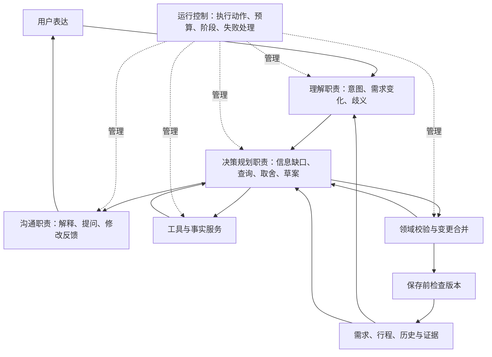

# TravelAssistant Agent 设计方案（讨论稿）

状态：早期讨论稿，保留历史设计。当前已实现主 Agent 与需求、查询、规划、调整四个子 Agent，共用一套工具循环。角色提示词、委派、共享预算与现有保存保护已接入；等待后持久恢复、用户取消和跨进程恢复尚未实现。

当前能力以 [角色 Agent 实现说明](agent-role-implementation.md) 为准。[V2 角色方案](agent-role-contract-v2.md) 的业务分工已获认可并落地；V1 的独立上下文子 Agent 方案已被否定。[旧全流程图与实际输入输出](agent-full-flow.md) 记录改造前版本。

## 1. Agent 的使命与边界

Agent 帮助用户把逐步形成的旅行想法，转化为符合个人偏好、受现实约束、可以解释和修改的旅行方案。

核心工作：理解用户表达，判断需要补充什么信息，获取相关事实，在时间、预算、体力与兴趣之间做取舍，并与用户协商。

| 责任 | Agent 做什么 | 系统提供什么 |
| --- | --- | --- |
| 理解需求 | 识别意图、提出需求变更、区分硬约束与偏好 | 有效需求档案、来源消息、修订号与更新规则 |
| 补齐信息 | 判断哪些缺口影响当前目标，提出关键问题 | 未知字段、查询状态、用户回答的保存 |
| 获取事实 | 决定查什么、为何查询，根据语境匹配候选 | 工具执行、参数校验、数据来源、证据引用 |
| 形成方案 | 选择地点、组合日期、安排休息，解释取舍 | 已查询事实、日期与交通等规则检查 |
| 修改方案 | 理解修改范围，提出变化与影响 | 变更合并、整份行程校验、版本保护 |
| 沟通结果 | 解释理由，区分事实、建议和待核实内容 | 校验结果、实际保存状态、来源与时间 |

Agent 可以提出建议，但不能自行解除必去、忌口、抵离时间等硬约束。无法同时满足时，向用户说明冲突并请求选择。用户明确修改要求后，由系统更新有效需求。

## 2. 建议的分层

第一版采用一个旅行 Agent，内部区分理解、决策规划和沟通职责。职责分层不要求每层都独立调用一次模型，也不要求拆成多个 Agent。



理解职责：回答“用户刚才希望发生什么”，提出需求补充或修正。补充忌口、解释方案、探索目的地、生成新方案和修改现有行程具有不同意图。

决策规划职责：回答“还缺哪些信息、需要查什么、应该怎样安排”。使用事实做选择，处理冲突，产生候选方案及取舍理由。

沟通职责：把已有决定表达给用户，只提影响当前目标的关键问题。表达阶段不能新增没有证据的排名、地址、营业状态或路线耗时。

运行控制：执行 Agent 提出的合法动作，维护本次工作状态，限制调用次数与总时间，记录进度与失败。它不决定用户更喜欢哪个景点。

领域与状态服务：查询与规范化外部数据、合并变更、检查可计算约束、保存版本。系统可以检查数据格式、来源和适用范围，但一次 API 成功不等于现实事实永远正确。

## 3. 工具与事实层

天气、热门景点、美食排行、交通路线都作为 Agent 可调用的独立能力。具体地点匹配是它们共用的基础能力。工具按当前任务需要调用，不要求每次全部执行。

| 能力 | 输入 | 返回内容与边界 |
| --- | --- | --- |
| 天气查询 | 已明确的城市、日期 | 预报、发布时间或查询时间、预报日期范围；超出范围返回不可查询，不把季节经验写成当天预报 |
| 热门景点发现 | 城市、兴趣、区域等筛选条件 | 有来源的候选、评分或热度指标及统计范围；普通地点搜索结果不能直接称为热度榜 |
| 美食与榜单查询 | 城市、菜系或菜品、预算或区域 | 门店候选、价格和评分等可用字段；真实榜单需给出平台、榜单名称、时间与排序依据 |
| 具体地点匹配 | 城市、候选名称、区域等线索 | 真实地点 ID、名称、地址、坐标；重名无法区分时待确认，不默认选择第一条 |
| 交通路线查询 | 已匹配起终点、交通方式；服务支持时含日期时刻 | 路线估算、距离、耗时、查询时间和适用条件；不支持出行时刻的服务不能宣称结果对应未来那一天 |

当前能力与目标能力要区分：项目已有天气、POI 地点、美食门店和路线工具。当前美食工具对一次返回的候选按评分排序，不能代表全城排名；当前尚无具有明确来源和统计口径的热门景点榜单工具。

热门景点与真实美食榜单的数据源需要另行确定。没有对应来源时，可以使用已查询的候选并说明推荐依据，但不能伪造榜单。地点存在不代表其开放时间、门票或预约状态已核实。

## 4. 减少幻觉的证据规则

增加工具之后，还需要约束“查询结果怎样进入方案”。

1. 用户确认的事实、外部查询结果、规划建议与未核实事项分开保存，不能互相转换。
2. 涉及地址、坐标、排名、天气、营业状态和路线耗时的具体断言，需要引用相应的真实工具结果。模型返回的是引用，服务端根据已保存结果绑定字段。
3. 查询结果携带来源、查询时间、地点或日期范围、状态和限制。缺失字段保持缺失；不能从 POI 结果推断当天营业，也不能从菜系推断菜品一定不含过敏原。
4. 评分排序需要说明排序对象和范围。对本次查询的十家门店排序，只能描述为本次候选中的排序。
5. 查询失败后保留原因与影响。可继续提供不依赖该事实的方向建议，具体路线和时刻仍待核实，不能用模型猜测替代查询值。
6. 新需求或地点变更会使相关证据失效。例如修改城市需重新匹配地点，换餐厅需重新查相关路段，修改日期需重新判断天气结果是否适用。
7. 沟通阶段引用已得到的事实与决定，不在润色时补出新事实。外部资料作为数据使用，不作为指挥 Agent 修改规则的指令。

例如：

- “预计公交 67 分钟”来自路线结果，并说明查询时估算。
- “建议额外留出 20 分钟”是规划预留，标为估算，不能写成工具核实的候车耗时。
- “这家餐厅适合当天路线”是 Agent 的建议，应说明它靠近活动地点等理由。
- “具体天气尚无法预报”是当前能力边界，不能补写一个温度让行程看起来完整。

证据引用与程序校验能够约束错误输出，不能保证外部数据完全正确，也不能消除偏好理解错误。重要结论仍需通过固定案例和真实使用反馈评估。

## 5. 单次工作流程

建议采用有边界的动态循环。先形成粗略候选和分组，再查询有关地点与必要路段，根据结果调整方案。避免在地点组合未确定时查询所有候选的两两路线。

```text
读取有效需求和当前行程版本
→ 理解最新消息及修改范围
→ 判断当前目标缺少什么
→ 提问，或提出候选与查询动作
→ 获取并记录事实
→ 形成或调整草案
→ 合并变更并执行校验
→ 根据问题修正，或向用户解释冲突
→ 检查需求与行程版本仍有效
→ 保存允许保存的草案/结果
→ 告知实际结果与待核实内容
```

执行期间可以在“查询—规划—校验”之间往返。例如路线过长时，Agent 可替换可选景点并查询新路段。无需让用户逐条执行查询或挑选普通候选。

动作建议包括：提问、查询工具、提出草案、提出变更、完成解释。系统执行合法动作；模型不能通过一句“已保存”改变数据库。

模型输出按当前工作缩小：理解阶段输出意图与需求变更；工具阶段输出查询请求；规划阶段输出业务草案或变更；沟通阶段表达结果。草案保留必要业务结构和证据引用，页面卡片、地图链接等展示内容由系统生成。无需每次同时输出聊天、想法卡、整份行程和内部事实对象。

修正有总次数和时间限制。首版建议沿用现有的一次校验修正上限，具体预算可在评审和案例验证后确定；超出时给出明确问题及当前状态。需要用户决定时停止并等待回答，恢复前重新检查需求和行程版本。

## 6. 三种典型交互

### 用户还在探索

用户：“想去杭州，轻松一点，先看看有什么值得去的。”

Agent 识别为探索，查询有来源的候选，按用户兴趣解释方向。没有日期和抵离时间也可以讨论，不要求先填写完整档案，不声称已生成精确日程。

### 用户要求生成方案

用户：“杭州三天，第一天中午到，最后一天傍晚走，灵隐寺必须去，不想太赶。”

Agent 提取要求；对影响精确排程的日期与抵离时刻提关键问题，用户允许先看方向时可提供粗略草案。选择候选、匹配地点、查询相关路线，安排餐食和休息，校验实际可用时段。

如果发现必去项目与轻松偏好冲突，先尝试减少可选项目。如果硬约束仍无法同时满足，说明冲突，提出可选择的调整方向，不擅自取消必去地点。

### 用户要求修改现有方案

用户：“下午这个景点换掉，想轻松一点。”

目标明确时只提出目标条目的变更，复用仍适用的证据，重新查询受影响路段，并验证实际合并后的完整行程。目标不明确时先问是哪一天或哪个景点。

如果修改必须牵动午餐或相邻活动，说明影响并请求扩大修改范围。全程重排只有在用户要求或同意该范围时进行。用户仅问“为什么这样安排”时，解释现有决定，不产生新版本。

## 7. 持续状态与结果语义

| 状态对象 | 保存什么 | 用途 |
| --- | --- | --- |
| 有效需求 | 硬约束、偏好、未知项、来源、修订号 | 长对话仍能保留要求，处理新旧需求关系 |
| 当前行程与版本 | 条目稳定 ID、时间、地点引用、历史版本 | 解释与局部修改有明确基准 |
| 事实记录 | 工具结果、来源、适用范围、查询时间、引用 ID | 复用有效证据，识别过期或不适用结果 |
| 本次工作记录 | 目标、需求及行程版本、动作、阶段、预算、问题 | 可观察失败原因与查询进度 |
| 决定与修改记录 | 选择理由、被舍弃的选项、修改范围和用户回答 | 回答为什么这样安排，保持后续决策一致 |

仅保存用于解释和继续工作的简短理由、动作与结果，不把完整模型内部推理作为业务状态。

任务生命周期与工作阶段分开。生命周期可以是等待执行、运行、等待用户、成功、失败或中断；工作阶段是理解、查询、规划、校验、修正、沟通。界面只展示实际阶段，不模拟进度。

结果需要分别表达：

- 内容状态：方向建议、草案、用户已确认方案。
- 证据覆盖：哪些地点和路段已查询，哪些事实仍未知。
- 校验状态：哪些规则通过、哪些未能检查、哪些存在冲突。
- 保存状态：是否保存、对应版本，或因输入已变化而未保存。

“用户已确认”不等于所有事实已核实。“时间校验通过”不等于开放、预约、预算和未来交通都已确认。不能用一个“已核实”状态掩盖未覆盖领域。

建议保留部分事实缺失的草案，并明确其适用范围；已知抵离越界、时间冲突或硬约束违背的候选不能替换为可用行程。修正失败、服务中断或需求已变化时，保留已有行程。

## 8. 校验和验收

确定性校验负责检查日期、时刻、重叠、抵离边界、真实路线耗时、条目身份和变更范围等可计算规则。预算只有在金额和范围足够明确时才能检查；兴趣和“轻松”等主观目标需要 Agent 解释和案例评估，不能宣称全部由程序证明。

建议固定以下案例作为设计验收：

| 案例 | 预期结果 |
| --- | --- |
| 只想讨论旅游方向 | 给候选与解释，不强制生成日程 |
| 早期明确了忌口，后面多轮聊天 | 有效需求仍保留，不因上下文截断消失 |
| 日期超出预报范围 | 不生成具体天气，说明何时需要再查 |
| 景点或餐厅没有榜单来源 | 不声称热门排名或全城前几名 |
| 地点同名且无法区分 | 询问关键线索或待确认，不默认第一条 |
| 路线查询失败 | 耗时未知，说明未完成可行性检查 |
| 路线耗时超过活动间隔 | 修正可选安排；仍冲突则解释并保留原方案 |
| 用户修改一个景点 | 只改授权范围，查询受影响路线并检查整份合并结果 |
| 必去与抵离时间无法同时满足 | 展示冲突，等待用户选择，不自行解除硬约束 |
| 用户问为什么这样安排 | 引用需求、查询结果与决定理由，不改计划 |
| 查询期间用户更新需求或恢复版本 | 旧任务结果不能覆盖新状态 |
| 用户确认一份仍有未知项的草案 | 保留未知项，不把确认升级为事实核实 |

验收不仅看 JSON 是否合法，还看事实有无来源、是否尊重需求、是否提出正确问题、修改是否越界、理由是否有依据。真实模型案例与工具服务失败案例都需要覆盖。

## 9. 建议的迁移顺序

1. 先明确职责与内部结果协议。现有页面、原想法白板、需求档案、地图展示、版本保护和当前工具继续保留；模型访问、Agent 工作流程与保存责任已开始拆开。
2. 建立本次工作状态与证据记录，支持根据查询结果继续规划。当前已建立受控 Loop，覆盖普通聊天事实查询、地点/路线规划、草案校验和一次修正；下一步验证阶段状态与证据的持久化。
3. 建立统一变更协议、结构化校验问题和结果状态；让任务进度来自真实阶段，验证局部修改和失败保护。
4. 选定真实数据源后补热门景点与美食榜单能力，再扩展开放时间、门票和预约。来源尚未确定时不承诺榜单功能已具备。

迁移采用可独立验收的小步骤。未来的阶段恢复不能假设重启后自动重放所有动作；应在状态记录和保存幂等可靠后单独设计。单进程与数据库全量快照的现有限制仍需另行解决，职责拆分本身不能解决多进程一致性。

## 10. 待讨论的产品选择

当前建议如下，尚未定案：

- 默认输出一个推荐方案，并解释关键取舍；偏好或硬约束有冲突时给两种有差异的选项，避免每次要求用户比较多份完整行程。
- 缺失信息按当前目标判断：方向讨论允许先推进，精确时刻排程只询问关键缺口。默认假设不能伪装成用户偏好。
- 暂时查不到部分事实时允许保存带未知项的草案；已知违反硬约束的候选不替换为可用方案。
- 热门景点和美食榜单各自确定数据平台、可用接口和统计口径。普通 POI 评分排序只能按实际范围描述。

总结：采用一个旅行 Agent，分清理解、决策规划和沟通职责；用独立工具与证据记录支撑事实，用领域校验保护约束，用系统管理执行和保存。评审先聚焦职责、流程与结果语义，再确定实现接口。
