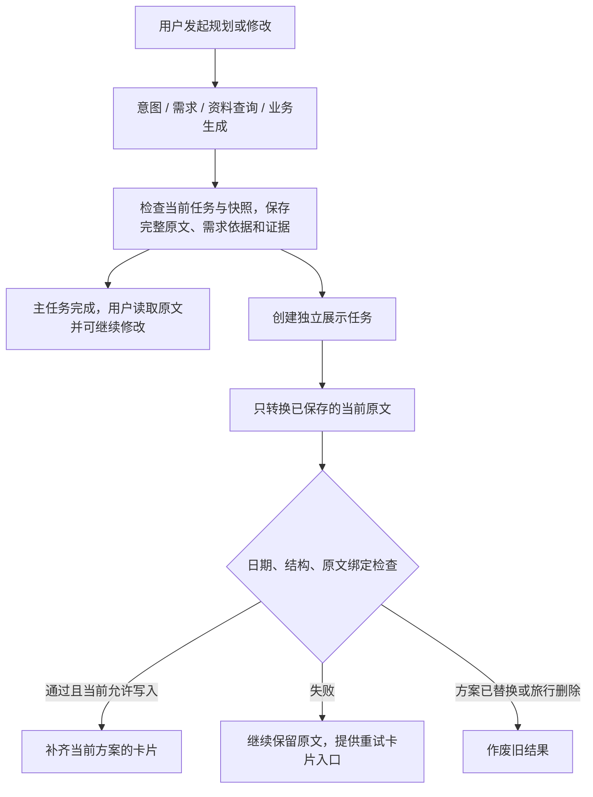

# Agent 规划体验与展示转换优化方案

状态：优化1、优化2已实施，业务轮次优化仍待后续。2026-10-12后的执行顺序、语义验收门槛与实验预算见[下一轮优化计划](optimization-plan-20261012.md)；本文保留前两批设计依据。依据2026-10-11当前Qwen27B真实规划测试、当前源码及[首版产品边界](product-boundaries-v1.md)第14项。本方案先完成文字先读、卡片后补及日期完整性，再优化规划轮次。

## 1. 要解决的问题与预期收益

四个场景各实测一次，均保存了规划原文；展示只有聊天当天场景通过结构与日期检查，语义尚未逐项人工评审。

| 场景 | 当前服务器响应就绪 | 文字生成完成 | 文字完成后额外等待 | 展示结果 |
| --- | ---: | ---: | ---: | --- |
| 聊天入口当天 | 62.9s | 34.9s | 约28.0s | 1天，结构/日期通过 |
| 页面入口当天 | 98.3s | 56.0s | 约42.3s | 1天原文提取成2天，回退 |
| 三日两晚 | 135.7s | 91.8s | 约43.9s | 3天只提取1天，回退 |
| 七日六晚 | 194.8s | 122.2s | 约72.6s | 7天只提取3天，回退 |

模型SDK等待占94%—98%，工具累计2.4—5.5s，SQLite保存0.04—0.06s、HTML响应0.08—0.10s。首批投入放在展示交付路径和转换完整性。

若保持同一份业务原文生成过程，把展示等待移出前台，文字可在约35、56、92、122秒后保存并提供读取，再加程序提交及页面发现时间。按本轮样本计算，理论上可移出约28—73秒等待，约为原总等待的32%—45%。这是基于已有时间线的估算，尚非改造后的实测承诺；没有让模型本身生成得更快。

本轮没有测实际浏览器可见时刻。实施后需要补浏览器测量；当前聊天轮询3秒、任务轮询2.5秒也会影响用户感知。

## 2. 第一批：完整文字先保存，卡片后台补齐（P0）

### 用户流程

这里的“主任务完成”仍要求业务回复合法、需求校验通过及快照未变化。只追问、业务失败或被新消息替代的旧轮，继续遵守已有保存保护，不能因为拆开展示而放行。

聊天入口先显示完整回复与查看行程入口；页面生成/修改在文字保存后跳到行程页。卡片未完成时显示一句“行程已生成，正在整理卡片”，后台失败则显示“卡片暂未整理完成，完整文字已保留”。卡片完成不再次导航，不自动收起正在阅读的原文，不清空修改输入或重置滚动位置。

### 后端组织

1. `TravelAgentRuntime` 的业务路径交付完整文字和候选需求/证据，前台不再同步执行 `convert_display()`。
2. Store沿用当前统一提交边界，原子保存原文、需求快照、证据和待转换状态。每份新原文设置 `display=None`、`display_status=pending`，不能保留上一份方案的旧卡片。
3. 将主业务任务置为成功并持久化后，独立调度展示任务。创建展示任务的持久记录与文字提交应一致，避免“文字已保存但找不到对应任务”。入队异常只影响卡片状态，不把主任务改成失败。
4. 展示只读已经提交的原文，日期依据取自 `TripPlan.requirements_snapshot`。用户后来改变旅行日期时，旧原文的卡片仍绑定旧方案日期；不得读取最新需求重新规划。
5. 通过单独的挂载方法更新当前计划的 `display`、`display_source_hash` 和 `display_status`。不能再次调用 `_apply_text_plan()` 重建整份计划，也不能覆盖正文、证据、需求、确认状态或计划ID。

建议增加独立持久化 `display_jobs`，与现有 `chat/plan/revision` 主任务分开，防止“卡片还在运行”继续锁住规划/修改按钮。任务记录至少包含：任务ID、旅行ID、计划ID、原文hash、计划依据的日期/需求快照、状态、尝试次数、创建/更新时间、错误类型和耗时。任务按旅行ID、计划ID、原文hash去重；每趟旅行只保留当前方案的待执行转换。

计划对外只需 `pending/ready/fallback` 等展示状态；队列的running、等待发布等细节留在独立任务记录，避免无关状态更新干扰业务快照。

### 发布条件与现有快照保护

当前 `_commit_agent_result()` 比较完整 `expected_plan_snapshot`，包括展示字段。用户修改行程时若后台同时补卡片，新修改会被误判为快照变化。首批采用以下明确规则，保留现有完整快照保护：

- 该旅行存在queued/running主业务任务时，不启动新的展示请求；已经生成的展示结果可以保存在独立任务记录中，等待主任务结束再发布。直接调用Store生成/修改的入口也要纳入统一业务执行标记，不能仅靠任务表判断正在运行的业务。
- 主任务运行期间，后台不改 `TripPlan` 的任何展示字段，连pending→ready/fallback状态也延后。业务快照由此保持稳定。
- 主任务结束后，在Store锁内重新核对旅行存在、计划ID、原文hash、计划依据快照及展示任务仍有效，再挂载结果。
- 若主任务保存了新方案，旧任务和待发布结果作废；若只进行了闲聊、查询、解释，原文与计划依据未变，则可以发布同一份原文的展示。
- 单独确认当前行程不允许后台恢复旧状态；挂载只更新派生展示字段，保留当下确认状态。

这比在首批重写“哪些计划字段参与并发冲突检查”更容易保持已有保护，也能避免重复转换未变化的原文。

### 调度、删除与重启

建议首版用单进程内有界调度，展示并发数为1，前台任务优先于尚未发出的展示请求。当前程序为单进程Store，无需此次引入Redis/Celery。已经发往Qwen服务的请求能否真正提前中止须验证服务行为；结果作废不等于GPU立即停止。后台不能无节制地与新规划请求抢占模型。

新方案替换时作废旧展示；清空聊天时取消未完成任务并保留已保存原文/卡片；旅行删除时清理对应展示记录，迟到回调检查旅行存在后才能写入。主业务仍queued/running时沿用现有删除保护，单独的卡片任务不应使用户永久无法删除旅行。

重启时把中断的展示任务标记为中断/回退，保留文字，提供显式重试入口；沿用目前“不自动重跑中断任务”的原则。旧方案没有展示任务时不批量发起转换。

持久化快照预计从schema_version=4升到5，缺少 `display_jobs` 的旧数据按空集合读取，旧ready/fallback展示保留。升级前备份SQLite，验证迁移后全部旅行和原文仍在。展示JSON的业务协议仍为1.0，这与数据库快照版本分别管理。

### 页面更新

建议增加小型、带登录与所有权校验的计划状态接口，返回当前计划ID、展示状态和更新标记；pending时轮询，ready后读取行程展示片段。后台完成只更新卡片容器，保持原文展开、修改草稿和阅读位置。收到其他计划ID的迟到响应直接丢弃。

活跃主任务状态可先按1秒轮询；卡片pending时按2秒轮询，完成后停止，页面隐藏时暂停、恢复可见时立即查询。第一批沿用轮询，先实测浏览器反馈；SSE留给后续需求，避免扩大本次改动面。

## 3. 第二批：让展示完整覆盖原文日期（P1）

### 日期框架由程序约束

目前请求Schema只有 `days.minItems=1`，1天、3天、7天使用同一结构；天数只能在模型返回之后检查。本轮三次都是JSON返回后发现日期框架不完整，并非HTTP超时。

建议每次请求根据已经保存的方案生成日期约束：

- `days.minItems = days.maxItems = N`，N取当前原文方案的日期框架。
- 日期字段限定到本方案日期及允许的null；继续由本地校验检查顺序、重复及日期一致性。null只用于原文明示“第N天”但未写完整日期、由程序映射的情况。
- 提示中明确按完整N天提取，不能把准备事项当成额外一天，也不能处理前三天后省略余下日期。
- 保持现有展示字段与前端协议；先做真实Qwen结构化输出兼容测试，不能仅凭HTTP200认定服务执行了这些约束。

日期数量正确仍不等于内容完整。验收不能接受复制同一天、塞空items或自行新增安排来凑N天。若原文本身缺日期内容，继续保留原文并记录来源覆盖问题，不让展示角色补写旅行计划。原文与JSON还须人工对照未知、估算、预算、预约、饮食和活动顺序。

### 独立预算与有限纠错

初始建议：展示转换执行预算180秒，从实际开始处理计时；排队和等待发布分别记录，不混入SDK耗时。最多2次模型请求，计数包含兼容降级；正常先一次转换。仅对明确的结构/日期校验失败尝试一次纠错，沿用同一份原文，提供具体错误和目标日期。剩余不足60秒或出现新前台任务时不追加请求。认证、网络不可达、来源不足不进行盲目重试。

这些是待验证的初始参数，不能宣称必然更快。卡片失败只改变卡片结果，主业务成功、原文和修改能力保持有效。严格覆盖7天后JSON可能更长、耗时更高，因此先把转换移出前台，再评估转换耗时和成功率。

若真实服务对数组长度约束支持不足，先比较“按日期设置必需对象键、程序转为days数组”的请求适配方案；仍不改变已保存的原文。按天拆分转换属于后续实验：只有能可靠定位每天原文片段才使用，模糊边界保留全文或回退；默认不并发7个请求争用同一Qwen服务。

## 4. 第三批：减少业务模型的重复工作（P2）

展示不再阻塞后，继续用时间线优化真正的规划时间。七日规划的业务模型累计116.6秒，这部分不会因后台卡片自动减少。

- 明确告诉业务角色哪些需求、日期窗口已经完整提供，减少同一轮重复 `read_context`；最新原话审阅、需求变更校验和必要证据读取仍保留。
- 利用已有同轮天气/路线缓存，核对是否存在不同查询词重复查同一目标；无变化不主动重查。
- 在已有授权和依赖明确时，让模型一次提出独立的天气、地点等查询，减少等待下一次模型再决定查什么。先减少模型轮次，工具并发收益另测；本轮工具累计只有2—5秒。
- 行程表达减少同一信息反复复述，不能用固定30字截断预算、预约或过敏条件。展示描述精简也须通过原文对照。

保持当前模型和角色配置作为起点。此前关闭display思考的对照没有显示提速收益，暂不统一改成none。更换展示模型、流式文字、SSE及“模型直接产JSON再生成文字”都作为独立后续实验；它们需要另评质量、工具契约和保存语义。

## 5. 必须同步改造的计时与验收

### 并发计时

现有 `Timeline` 的自身耗时加和建立在串行阶段树上。后台模型与页面响应并行后，不能把所有跨度相加当总等待，否则会把并行工作重复计算。

新增foreground/display/http等执行轨道及任务ID归属。前台从接受请求到文字可读就绪单独计时；后台从入队、开始请求到转换/发布单独计时，完整流水保留Chrome/Perfetto并行轨道。总工作跨度与用户等待分开呈现，重叠时不再要求“全部类别相加=整体墙钟”。测量器要等展示任务结束或回退再收尾，避免主任务结束后卸载hook丢掉后台数据。

新增浏览器真实测量：完整原文可见、卡片可见、跳转/轮询等待、转换期间能否修改。现有内部 `prose_generated_seconds` 不直接改名成用户可见。

### 测试范围

| 检查 | 验收方式 |
| --- | --- |
| 展示不阻塞文字 | 阻塞展示SDK，主任务已完成、原文已落盘、页面能读；允许提交新修改 |
| 旧结果保护 | 新方案先保存再释放旧展示，旧正文/JSON/证据不回写；删除旅行后不复活 |
| 快照不误冲突 | 用户修改期间旧展示先完成，先等待发布；主任务完成后按新/旧计划绑定决定发布或作废 |
| 日期依据不漂移 | 修改当前需求但不重排，旧原文展示仍使用旧计划需求快照中的日期 |
| 展示失败保护 | 非法JSON、日期错误、超时、队列失败、重启中断都保留原文，主任务成功不被翻转 |
| 页面阅读状态 | 卡片到达不重置输入、滚动、原文展开，不反复跳转；迟到片段不覆盖新方案 |
| 天数与语义 | 1、3、7天，跨月、“第N天”、模糊时间、未知价格、预算额度、严重过敏逐项对照 |
| 原有功能 | 全部自动回归、6套浏览器回归、数据集当前系统案例和数据库迁移检查 |

v2的T008文字先读、T009迟到卡片保护转成可执行验收；原先“展示还属于主任务时新消息作废”的测试要拆成业务提交前作废和独立展示过期两类，保留两种保护。

### 实测目标

先固定本轮四份规划原文及其日期框架，直接做展示转换对照，每份至少3次；不要每次先重新规划，造成输入长度变化。再跑原有四个完整规划场景，每例至少3次，同模型、协议、角色参数及源码记录，保存首轮失败和补测。

- 前台：目标为文字生成到回复保存小于1秒；可见页面在服务器就绪后3秒内呈现完整文字。按测试环境实测，不作为已达到的SLA。
- 发布：错天数/错日期卡片零放行；固定四份原文的12次日期框架完整是目标，未达到就继续记录回退，不能宣称已解决。
- 质量：未知、估算、预算口径、预约与过敏条件没有因为提速而丢失；结构正确不代替语义验收。
- 并发：过期卡片零回写，前台修改不因派生卡片更新而误冲突。
- 指标：分别报告文字可见、卡片就绪、主业务模型/展示模型耗时、重试、fallback、token、后端调用、缓存、前台请求在后台转换期间的延迟。

## 6. 改动范围、交付顺序与回退

| 模块 | 预计改动 |
| --- | --- |
| `app/agent_runtime.py`、`app/agent_client.py` | 主业务与展示入口拆开，展示使用独立预算及已保存原文 |
| `app/tasks.py`、`app/store.py` | 主任务提前终态、展示任务去重/发布、快照保护、删除/清空/重启 |
| `app/models.py`、`app/persistence.py` | 待转换状态与展示记录持久化，旧库兼容 |
| `app/plan_display.py`、展示提示词 | 动态日期约束、校验错误分类、有限纠错 |
| `app/main.py`、行程模板、前端脚本 | 状态/片段接口、局部更新、轮询与阅读状态保持 |
| `tests/automated/`、`tests/browser/`、`tests/performance/` | 新生命周期、并发安全、真实可见时间及并行报告 |

第一批整体交付文字先读、独立展示任务、页面更新及并发/重启保护；后台任务与保护不能只做一半。第二批交付日期完整性和有限纠错。第三批基于新数据减少业务轮次。每批重新评测，分开说明收益。

建议提供展示任务开关。关闭后停止创建新展示任务并使旧待执行任务失效，文字继续正常交付，已有ready卡片可继续显示。回退以功能开关关闭后台转换为主，不直接用旧版本程序写入新数据库；涉及数据库降级时使用升级前备份和受控迁移。

优化1已落实独立展示任务、原文先交付、片段更新、快照/作废/重启保护及并行计时。优化2已增加动态日期约束和一次有限纠错，转换仍需原文对照评审，不能以结构通过代替语义质量。

## 证据

- [首版产品边界](product-boundaries-v1.md)、[当前架构](agent-architecture-current.md)、[已知根因](workflow-root-cause-20261010.md)。
- [场景耗时测试集](../tests/datasets/agent_latency_v1/README.md)、[业务与展示评测集](../tests/datasets/travel_agent_v2/README.md)。
- 本轮真实报告：`C:\Users\16156\AppData\Local\Temp\agent-latency-planning-20261011-123340\report.html`；原始结果、源码指纹与输入同目录留存，各例一次，业务快照未变化。
