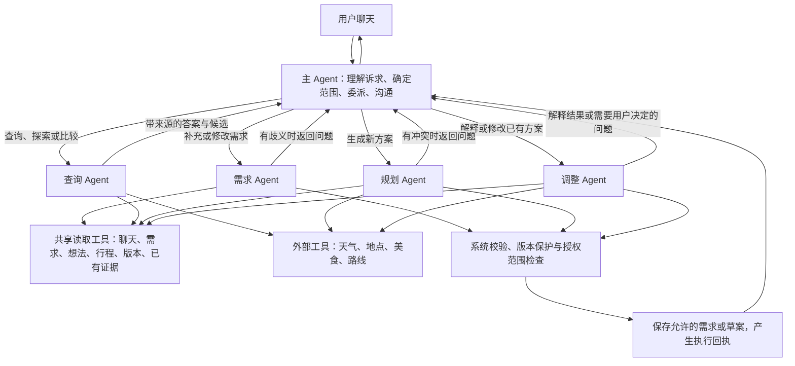

# Agent 角色方案 V2：按任务委派子 Agent

状态：业务角色分工已获用户认可，并按随后确定的“提示词 + 工具集合 + 共用 Loop”完成首版实现。本文件保留设计讨论；实际执行协议、验证与边界以 [当前实现说明](agent-role-implementation.md) 为准。旧的 [全流程图](agent-full-flow.md) 记录改造前版本。

## 1. 这版的核心结构

采用 **一个主 Agent + 四个业务子 Agent**。主 Agent 从聊天理解用户此刻想做什么，然后委派对应任务。子 Agent 为自己的任务获取上下文、调用工具、作出任务内判断并提交结果。

上下文获取是所有子 Agent 的共同能力，不单独设置 ContextAgent。主 Agent 不必先替子 Agent 找齐需求、行程和事实，也不必拿回材料后再从头完成任务。



图表示可调用能力，不要求每次都走所有节点。校验问题返回原子 Agent 作有限修正；写入结果才由主 Agent告知用户。

## 2. 主 Agent：理解并委派

初始输入是最新用户消息、相关的最近聊天和明确的待回答问题。用户与旅行身份、当前日期、执行基线由系统绑定；不默认给主 Agent 装入整份行程、全部需求和工具结果。

主 Agent 负责：

- 判断用户在闲聊、补充需求、探索信息、生成、解释或调整行程。
- 判断用户明确授权了什么，保留原话；涉及“可以”等表达时关联之前具体的问题。
- 选择对应子 Agent 并说明目标、范围、交付物。
- 处理多任务之间的依赖，例如先更新预算，再按新预算规划。
- 根据子 Agent 结果和系统回执回复；需要用户取舍时转述问题。

主 Agent 不必先知道被修改条目的具体 ID。可以委派“定位用户所说的第二天晚餐并替换，其他安排不变”，由调整 Agent 完成定位和执行准备。找不到唯一目标时，子 Agent 返回歧义，主 Agent 再询问。

不新增一个独立意图分类模型。主 Agent 的一次决策同时理解聊天并选择回复或委派。闲聊可直接结束，不调用子 Agent。

主提示词要点：

```text
你是用户唯一可见的旅行协作 Agent。
从聊天理解当前诉求和用户授权范围，选择回复、询问或委派业务子 Agent。
委派时传递用户原话、相关对话、任务目标和边界，不提前猜定缺失目标或需求。
简单闲聊直接回复，不强迫用户补齐旅行档案。
子 Agent 能自行获取执行上下文；不要代替它预先执行整套检索和规划。
多个目标按实际依赖执行。用户仅更新需求时不自动重排行程。
子 Agent 返回歧义、冲突或扩大范围请求时，由你与用户协商。
依据真实执行回执报告保存结果，不在润色时加入新的事实或更改方案。
```

## 3. 四个业务子 Agent

### 3.1 需求 Agent：把聊天转成有效需求变更

输入：用户原话、相关聊天、更新目标和系统绑定的需求基线。

自行获取的上下文：当前有效需求；只有“之前”“还是原来那个”等表达需要检索相关历史。普通明确字段更新无需扫描全部聊天。

工具：读取需求、检索聊天、读取消息、读取相关想法、校验需求变更、提交需求候选。

交付：经过校验的字段级变更、原文依据、需要说明的冲突；由系统保存后附实际变更与新 revision。

边界：不能生成或修改行程；不能把假设、提问、朋友偏好或助手建议写成用户硬约束；不能自动恢复已撤销要求。

提示词核心：

```text
根据本轮用户表达整理有效需求。先读取当前需求，明确字段新增、修改或撤销。
涉及历史指代时主动检索来源；无法唯一确定则返回待询问问题。
保留本轮变更授权的原文依据，列表用明确添加/移除，不覆盖未提及字段。
检查预算口径、日期时刻、人数和抵离关系；不知道的值保持未知。
提交需求候选或返回歧义，不替用户重排行程。
```

### 3.2 查询 Agent：完成事实查询和探索比较

输入：用户问题、查询目标、必要的聊天线索。

自行获取的上下文：当前城市与日期、相关兴趣、忌口和预算；比较既有候选时读取对应聊天及已有证据。

工具：共享读取工具，以及现有 `query_weather`、`search_places`、`search_food`、`query_route`。

交付：能回答问题的结论、候选和比较理由、证据引用、适用范围、未能核实的信息。没有新行程版本。

边界：POI 搜索不能写成热门榜单；门店查询评分排序不能写成全城排名；没有新的来源就不能补写温度、营业、预约或评分平台。候选餐厅的菜系不能证明菜品无过敏原。

提示词核心：

```text
解决用户提出的旅行信息问题。按当前问题获取必要上下文，选择最少且足够的查询。
根据语境匹配地点；重名无法区分时返回候选和关键问题。
答案和具体事实绑定真实结果，保留来源、查询时间、范围和限制。
可以给出有理由的推荐，但区分工具事实和推荐判断。
查不到就报告未知，不生成行程或修改用户需求。
```

### 3.3 规划 Agent：从需求形成新方案

输入：明确的生成目标、用户原话、授权范围；若前序需求更新成功，使用更新后的基线。

自行获取的上下文：完整有效需求、相关想法和聊天、已有行程中明确要求保留的内容、已有可复用事实。

工具：共享读取工具、四个外部工具、草案校验、提交草案候选。

交付：完整行程草案、安排理由、可信地点/路线引用、未知项、校验结果；系统允许保存后附计划和版本回执。

内部循环：读取需求 → 选择候选与分组 → 查询必要事实 → 排程 → 校验 → 最多修正一次 → 提交或返回问题。路线过长时可以调整授权范围内的可选安排，再查询受影响路段。

边界：不能擅自解除硬约束；不默认未知的抵离时间；接驳、候车和安检额外预留须标为估算。不存在可靠开放/预约来源时保留未知。

提示词核心：

```text
完成用户授权的新旅行方案。先读取全部当前硬约束，再按任务选择相关历史与事实。
围绕实际可用日期、抵离边界、兴趣、预算和体力做安排，说明取舍。
具体地点和路线通过真实工具获得；先选必要候选，再查询相关路段。
使用系统校验结果修正草案；不通过删除硬约束规避问题。
返回可检查的草案、证据引用和未知项；系统保存前不声称已经生成新版本。
```

### 3.4 调整 Agent：理解和处理已有行程

输入：用户反馈或解释问题、修改范围、相关聊天、系统绑定的当前计划基线。

自行获取的上下文：当前行程、所指目标、完整硬约束、目标前后必要安排、版本来源、已有安排理由和相关事实。

工具：共享读取工具、四个外部工具、合并后校验、提交变更候选。解释模式只开放读取工具；用户要求核实时才开放必要外部查询；修改模式才开放候选提交。

交付：解释结果，或准确到目标条目的变更、原因、影响与校验结果；需要移动邻居时返回扩大范围问题。保存后附新版本回执。

边界：解释问题不产生新版本；没有记录的历史理由不能补造；局部修改必须检查完整合并结果，不能私自改变邻居安排绕过冲突。用户明确要求全局重排时，可以在授权范围内产生整份修改草案。

提示词核心：

```text
处理用户对已有行程的解释或修改请求。先定位目标和模式，再获取相关上下文。
解释模式引用真实的安排、已记录理由和证据；没有记录的原始理由明确说明。
修改模式只调整授权内容，查清饮食、预算、时间和邻居路线约束。
把修改合并到原行程后校验；不能改未授权邻居的时间或地点。
必要时返回一个具体的范围扩大或目标消歧问题；不自行替用户决定。
```

规划和调整可以共享代码与工具实现，但使用不同提示词、上下文装载策略、动作权限及验收标准。它们分别围绕“新方案”和“已有方案的保留/变更”完成任务。

## 4. 上下文工具作为共享能力

| 能力 | 内容与边界 |
| --- | --- |
| 读取有效需求 | 完整当前硬约束、偏好、未知项和 revision；缺失来源不能补造 |
| 检索和读取聊天 | 命中片段、消息原文和相邻语境、来源 ID、检索覆盖与截断状态 |
| 读取想法 | 想法内容、作者、状态和来源；不自动等于必须执行的要求 |
| 读取当前行程 | 指定目标、日期、邻居或完整行程；附当前计划及内容基线 |
| 列出/读取历史版本 | 版本 ID、变更摘要和历史内容；明确区别当前与历史 |
| 读取已有证据 | 来源、查询时间、范围、限制和失效状态；不自动重新查询 |

子 Agent 在自己的 Loop 中选择读取范围，并补查缺口。生成或修改时必须完整取得当前硬约束；不能把所有“完整上下文”理解为固定取最近几条消息。

读取由系统限制在当前旅行，使用一致的需求/行程基线。历史记录不覆盖当前有效需求。没有检索到不等于从未存在；不够完成任务时返回缺失或歧义。

外部工具实现共享，权限按角色绑定。规划和调整可以直接调用事实工具，不必每查一个地点就嵌套启动查询 Agent。查询 Agent 用于主 Agent 委派的独立查询/探索任务，首版子 Agent 不互相递归委派。

## 5. 委派和返回协议

主 Agent 传递任务意图和范围，不预先拼装所有上下文。以下为协议示例，非实际运行记录：

```json
{
  "agent": "revision",
  "goal": "替换用户所指的晚餐，其余安排保持不变",
  "user_quote": "晚饭换一家，其他安排别动",
  "related_message_refs": ["message:example"],
  "scope": {
    "target_hint": "用户所指晚餐",
    "allow_neighbor_schedule_changes": false
  },
  "deliverable": "目标明确且通过合并校验的行程变更，或需要用户回答的问题"
}
```

旅行/用户身份、任务与动作 ID、授权依据、版本基线和共享预算由执行层绑定。模型提供的授权解释必须与原聊天和当前会话关联；不能靠一句“已获授权”放行写入。

子 Agent 返回统一外壳，业务结果分别使用需求 patch、事实结论、草案或行程变更：

```text
AgentResult
├─ status：ready / needs_input / partial / failed
├─ artifact：需求变更 / 查询结论 / 行程草案 / 修改方案 / 解释
├─ source_refs：用到的真实消息、需求、计划、工具证据
├─ basis：需求与计划基线
├─ validation：已通过、未覆盖和失败项
├─ questions：必须由用户回答的关键问题
├─ pending：未核实事项
└─ summary：给主 Agent 的简短结论
```

`ready` 表示候选结果已准备好；不代表写入成功。系统执行层校验并应用后另附 `ExecutionReceipt`，明确是否保存、实际变更、新 revision/plan/version 或冲突原因。

任务结果和完整工件分开存储。主 Agent 通常只需要简短结论、必要问题和执行回执；不必重新读完整行程再重写。涉及事实的最终正文仍使用已有证据，不在汇总时增加具体声明。

## 6. 同一条消息中的组合任务

例：“预算改成人均 2000，然后按新预算重新安排。”

```text
主 Agent 识别两个依赖动作
→ 委派需求 Agent 提取与校验变更
→ 系统应用需求并返回新 revision
→ 主 Agent 使用新基线委派调整 Agent
→ 调整 Agent 获取最新完整需求与当前行程，查询必要事实并修改
→ 系统校验并保存新版本
→ 主 Agent 报告实际结果
```

如果需求更新成功而行程调整失败，回复分别说明两项结果。不得用旧 revision 继续调整，也不能把整轮描述成全部成功。

独立查询可以按需并行；依赖需求更新的规划与修改必须串行。同一旅行的写入保持版本与范围保护。

## 7. 闲聊与延迟

| 场景 | 执行方式 |
| --- | --- |
| “你好”“谢谢” | 主 Agent 一次调用直接回复 |
| “人均预算改为 2000” | 主 Agent 委派需求 Agent；系统完成校验保存，使用实际变更生成简短确认 |
| “杭州有什么值得去的” | 主 Agent 委派查询 Agent，返回候选与依据，不强制先填完日期 |
| “生成两天行程” | 规划 Agent 自行获取需求与事实并完成候选方案 |
| “为什么下午去这里” | 调整 Agent 的只读解释模式；只在需要历史/计划依据时调用 |
| “换掉第二天晚饭” | 调整 Agent 获取目标和约束，完成授权修改或返回歧义 |

按任务委派需要额外模型调用。需求更新通常至少包含主 Agent 决策和需求 Agent 执行两次调用，不能承诺一定比当前一次调用更快。可以通过短委派消息、精简返回、系统生成更新确认以及按角色选模型控制延迟；不固定增加一次仅润色回复的模型调用。

涉及写入的确认文本必须在成功回执后发送。纯闲聊可独立做流式输出。规划期间是否允许新消息并发仍需要改任务执行机制，角色拆分本身不能解决现有任务互斥。

## 8. 系统负责的保护与停止

- 所有子 Agent 消耗同一主任务预算，包含模型兼容回退、外部查询和自动补查；在执行批次前检查余额。
- 子 Agent 在完成候选、需要用户信息、遇到不可消除冲突或预算耗尽时返回，不能无限检索。
- 首版草案校验失败最多修正一次；已知硬约束冲突不能保存为可用方案。
- 参数校验、可信 POI/路线绑定、日期/时间规则、合并范围和保存由确定性系统执行，不设置另一个模型作为这些规则的唯一检查器。
- 原行程、需求或版本在执行期间变化时拒绝过期结果。待用户补充后用新基线继续，不重放旧写操作。
- 确认当前版本、恢复明确版本由主 Agent 请求确定性系统动作，不另建版本管理 Agent。目标含糊时先读取版本元数据或询问；恢复不能伪装成所有事实已重新核实。
- 不同业务角色的提交工具是不同权限。需求 Agent 不能提交行程；解释模式不能提交变更；查询 Agent 不能写用户需求。

## 9. 与 V1 及当前实现的关系

| 方面 | V1 方向 | V2 方向 |
| --- | --- | --- |
| 子 Agent 任务 | 收集上下文后交回主 Agent | 获取上下文并完成指定业务任务 |
| 规划与修改责任 | 主要在主 Agent | 由对应业务子 Agent 执行 |
| 上下文获取 | 单独 ContextAgent | 各子 Agent 共用读取能力、按需调用 |
| 主 Agent 收到什么 | 原材料与歧义 | 可应用的任务结果、问题或失败说明，以及系统回执 |
| 闲聊 | 主 Agent 直接回答 | 继续由主 Agent 直接回答 |

这版的角色分工已实施，详细差异见当前实现说明：读取统一为 read_context，候选提交在无工具调用的最终回复处处理，需求先在本轮快照中校验并在回到 Store 后保存。现有需求、地点/路线工具、校验与版本保护继续复用；持久等待恢复、任务取消和多进程一致性仍未实现。

评审先看两个问题：业务子 Agent 是否真正接手了任务；主 Agent 是否能仅依靠聊天决定委派，而无需先装入全量旅行数据。角色数量与预算配置可以在这一分工得到认可后再细化。

总结：主 Agent 理解用户并委派业务任务；需求、查询、规划和调整子 Agent 在自己的任务里主动获取上下文、使用工具并交付结果，上下文检索不再作为单独的子 Agent 职责。
