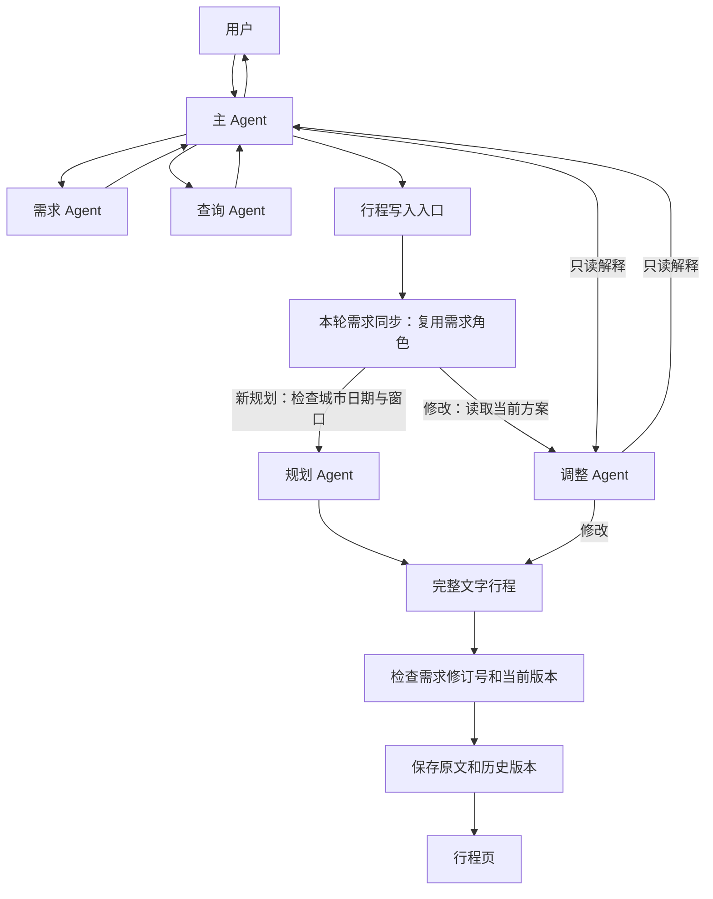

# 当前实现：文字行程与独立行程页

新行程由规划 Agent 直接输出文字，调整 Agent 输出修改后的完整文字；系统将原文保存到行程页和历史版本。不再生成行程 JSON 或局部 patch，没有结构化 Agent，也不解析文字中的日期、时间、字段或引号。入口、证据与统一保存的最新边界见[当前架构](agent-architecture-current.md)。

## 执行链路

仍然是主 Agent、需求、查询、规划、调整五个角色，共用 `TravelAgentRuntime.run_role()` 与 `AgentLoop`。主 Agent 从最近 8 条已完成聊天、最新消息与当前日期判断回复或委派，业务子 Agent 获得完整有效需求，按需读取本旅行聊天、想法、当前方案、历史版本与工具证据。

- 规划：本轮需求同步不能跳过，缺城市或具体起止日期时在查询前停止；通过入口后查询必要事实并交付完整文字行程。
- 调整：写入前同样同步本轮全局需求，局部备注不写成全局要求；读取 `plan.text`，旧方案读取 `plan.days`。用户反馈与系统指令分开，完整新文字进入与聊天相同的最终保存边界。
- 解释、查询和普通聊天：只回复，不创建行程版本。
- 需求：继续使用原有内部需求 patch 更新档案，保留来源与 revision 校验。这次移除的是行程输出协议，工具参数和需求档案的数据接口继续使用 JSON。

规划/调整请求不带 response_format，不经过 JSON 转换、结构校验、格式修正或交付后的自动路线补查。工具仍由 Agent 在共用 Loop 中显式调用；工具参数错误以工具结果反馈。需求候选保留原有的一次内部格式修正，不用于行程。

城市或具体起止日期缺失、日期倒置或当天抵离时刻冲突时，系统规划入口直接提出补充问题，不调用规划模型或外部查询。其他关键未知与业务冲突仍由角色以“需要补充：”或“需要确认：”暂停交付；非空文字不等于所有语义已经通过自动检查。

## 保存、修改和页面

`TripPlan.text` 与 `PlanVersion.text` 保存完整原文，`has_content` 同时支持文字和旧 `days`。新方案不填充虚假的活动数组、天数统计或时间线。原文不经过标题/备注长度截断，页面按段落和换行展示并自动转义 HTML。

行程页保留，文字方案显示当前版本、状态、确认按钮、查询依据和“想怎么调整”输入框。`evidence`保存实际工具记录，`requirements_revision`记录保存时的需求依据，均随历史版本恢复；需求后续更新时提示方案尚未重新规划。确认只更改状态，不代表事实已经核实。

旧行程保持原时间线、地点与路线卡片，不批量迁移或删除。旧条目调整后生成完整文字版本；旧的结构化版本仍能恢复，文字版本也能恢复。切换版本时只显示对应方案，不把旧活动与新文字混在一起。

清空聊天不会删除行程、需求或版本。SQLite 使用已有快照和 JSON 列保存 text、evidence与需求依据修订号，无需新增表；旧记录缺少字段时分别读取为空文字、空证据和未知依据。

## 保留的执行保护

- 新聊天消息可立即替代本旅行正在排队或执行的聊天、生成和修改任务，旧任务标记为 `superseded`，移除旧思考气泡。新任务使用独立模型消息列表和预算，不等待旧请求返回；已保存需求、行程和已完成聊天仍可作为上下文。
- 旧轮在模型返回、后续工具调用及保存前检查是否已被替代。迟到回复、需求更新、想法、行程和失败消息均不回写，旧任务也不能再重试。SDK 的阻塞 HTTP 调用及远端推理未必立即停止，旧响应即使返回也会丢弃。
- 任务 request_id 去重、失败重试、刷新查询和服务重启后的中断标记。
- 全轮共享最多 16 次模型请求、64 次工具调用、32 次外部查询与 240 秒检查点期限。
- 任务直接采用生成/修改函数返回的本次回复判断结果，避免把并发确认消息误当成生成成功。
- 需求更新先在私有快照校验；后续规划失败可以保留有效需求更新并分别报告结果。
- 保存时核对需求 revision、当前计划 ID 和内容快照。新需求、编辑、确认或恢复不会被迟到模型结果覆盖。
- 查询、解释和普通聊天没有计划写入权限。模型调用失败、空回复或明确补充问题不生成新版本。

角色默认思考强度仍为 main/requirements/research low，planning/revision medium，revision explain low，配置见 [思考强度说明](model-reasoning.md)。结构化角色及其环境变量已移除。

## 当前取舍与验证

新文字方案不再运行按活动字段执行的日期覆盖、时间重叠、交通窗口校验，也没有程序级“只改某一字段”的证明。硬约束、事实来源和修改范围交给业务 Agent 遵守，并在文字中说明未知；这减少了转换和修正环节，同时降低了自动检查能力。旧格式读取及测试用的规则函数仍保留，不接入新文字生成链路。

真实合成案例在独立临时 SQLite 完成：生成 70.89 秒、追加午餐提醒 25.70 秒、只读解释 11.80 秒。生成和修改各新增一个版本，解释不创建版本；确认、重启和恢复保留原文；行程请求均没有 response_format，业务数据库哈希未变化。该案例与此前 228 秒的案例不同，不能作为受控提速对比。

该次人工审阅也发现模型在天气查询超出范围后仍补入了没有工具支持的气候温度范围，并沿用了没有独立验证的反向路线耗时。测试通过说明执行和保存链路可用，不代表自然语言事实全部可靠。此轮记录这些模型质量问题，没有为它们增加文字解析或额外修正规则。

- `test_text_itinerary.py`：完整原文、修改、只读、旧/新版本互相恢复、SQLite 重启、清空聊天、页面转义与过期结果保护。
- `tests/text_itinerary_browser.cjs`：隔离应用验证生成、修改、刷新、四种宽度、确认、恢复、清空聊天与 HTML 转义。
- `tests/live_text_itinerary_case.py`：真实模型/工具与独立 SQLite，日志位于系统临时目录；结果位置记录在 `.cache/text-plan-live-location.txt`。

文字改造阶段 Python 回归282项通过（21.48秒）；本次入口与证据重构后329项回归通过，文字行程、聊天、需求、任务、旧时间线及地点/路线浏览器验收通过。历史备份路径见 `.cache/text-plan-backup-path.txt`，本次改造前备份与新验证范围见[当前架构](agent-architecture-current.md)。这些本地改动尚未提交或推送。

仍有限制：单进程 SQLite 全量快照，无用户取消、跨进程一致性、持久 Loop 恢复或流式输出；文字新版本目前会完整重输出，不承诺固定耗时。

总结：保留行程页，生成和修改直接交付文字，系统负责版本检查与原文保存；移除结构化转换及其修正环节，明确自动校验减少后的能力边界。
