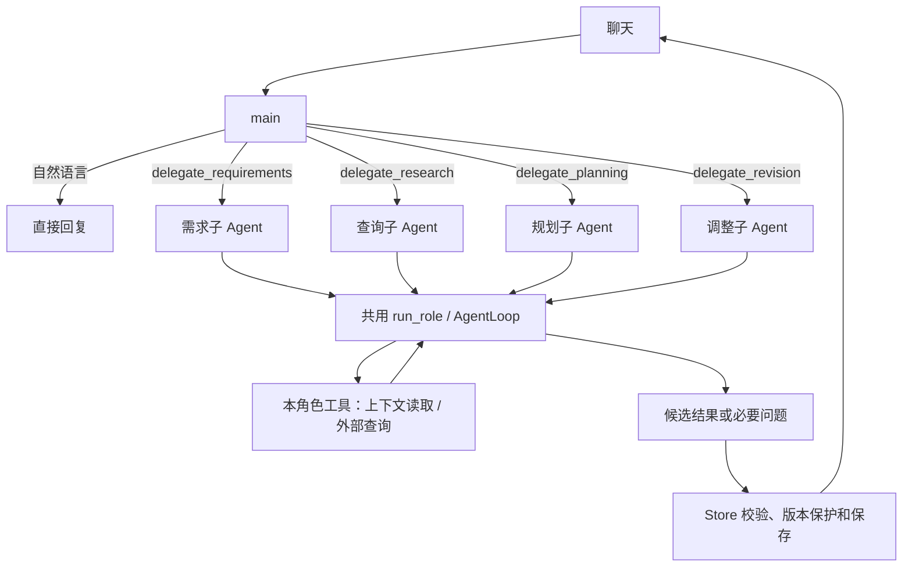

# 主 Agent 与四个子 Agent：当前实现

本版按“提示词 + 工具集合 + 共用 Loop”实现。这里描述已接入代码的能力；V1/V2 文档保留讨论过程，旧的 `agent-full-flow` 图和运行证据描述改造前版本。

## 1. 文件与执行入口

| 文件 | 职责 |
| --- | --- |
| `app/agent_roles.py` | main、requirements、research、planning、revision 五个角色的提示词、工具白名单、步数和修正输出格式 |
| `app/agent_runtime.py` | 所有角色共用 `run_role()`；处理委派、快照读取、候选结果和共享预算 |
| `app/agent_loop.py` | 共用的状态/动作循环控制器 |
| `app/agent_client.py` | 保留 `generate_agent_reply()` 兼容入口，访问模型、解析业务输出和处理错误 |
| `app/prompts/agents/*.txt` | 五份角色提示词 |
| `app/store.py` | 最终需求/计划检查、局部合并、保存及版本操作 |

模型返回工具调用时执行并回传，返回正文时解析并结束。子 Agent 不再先执行固定的信息收集 Loop 再切换规划 Loop。主 Agent 的委派本身也是工具调用；子 Agent 没有递归委派权限。

## 2. 上下文与工具

主 Agent 初始获得当前日期、最新用户原文、最近 8 条已完成消息，不默认加载全部需求、计划和历史。意图由模型通过回复或选择委派工具表达，不增加独立分类器。

所有子 Agent 获得完整有效需求以及旅行基础字段。`read_context` 支持读取 requirements、plan、messages、ideas、versions、evidence；聊天和想法支持简单关键词检索与分页，返回总数与下一页，当前完整硬约束不分页截断。历史来源不存在时不会编造。

一次运行使用 Store 提供的私有快照。模型无法指定其他用户或旅行的读取范围。当前证据包括行程中已有的可信地点、该轮查询结果和路线缓存；未持久化的历史天气/美食查询暂不能结构化跨轮复用。

| 角色 | 工具 | 最终输出 |
| --- | --- | --- |
| main | 四个 delegate 工具、read_versions、change_version | 自然语言，或直接采用子 Agent 的结果 |
| requirements | read_context | body、requirements_patch；可选整理本轮 idea_cards |
| research | read_context + 四个外部查询工具 | 带来源的自然语言答案；返回 plan/patch 不会写入 |
| planning | read_context + 四个外部查询工具 | body、plan 或 needs_input 问题 |
| revision | 修改模式同 planning；explain 模式只开放 read_context | 解释，或带 target_item_id 的修改候选 |

外部查询继续使用高德地点/美食/路线和 Open-Meteo 天气。普通 POI 查询不是景点榜单，门店评分排序不是全城美食排行。

## 3. 委派与结果

委派参数包含 task、user_quote、finish_turn；调整还包含 scope=explain/item/all。user_quote 必须为最新用户消息中的连续原文。它提供可核对的文字依据，不能单独证明模型语义判断正确；否定、假设、指代和授权范围还依赖提示词及真实模型验收。

主 Agent 一次只能委派或执行一个动作，组合请求按依赖顺序继续。`finish_turn=true` 表示这是最后一个任务，直接采用子 Agent 的结果结束本轮，省去额外的润色调用。子 Agent 返回问题或失败时立即结束，避免忽略问题继续执行。

工具返回只包含简短结果、是否有候选计划及需求是否已暂存。完整候选计划留在运行时，主 Agent 不能用自己的正文或 JSON 覆盖经过检查的子 Agent 草案。

解释模式没有写入能力；研究和主 Agent 的普通正文即使包含 plan/requirements_patch，也不会通过解析进入保存层。

## 4. 需求、规划与修改保护

需求子 Agent 的变更先用现有 `chat_changes` 和 `update_requirements` 在私有快照中验证；列表显式 add/remove。后续规划立即使用更新后的需求，最终返回 Store 时再次核对原需求修订号并应用。

这是本版对“每个子任务立即写数据库”的简化：整轮结束后统一回到现有 Store 保存路径。若后续规划失败，已校验的需求变更仍可返回并保存，失败回复明确写出需求更新成功、行程未更新。外部需求在运行期间被修改时，旧候选整体拒绝覆盖。

规划和调整按已有解析规则忽略模型自报地点坐标与路线元数据；可信 POI 引用与真实路线由系统绑定。业务校验失败最多修正一次，修正保留已有工具消息和查询缓存。

聊天中的单项修改与页面修改共用 `_apply_agent_revision`：只更新目标业务条目，保留邻居 ID/安排和整份计划的其他内容，允许更新受影响的路线元数据；合并后再次校验。

最终保存同时检查需求 revision、计划 ID 和计划内容快照。内容快照防止用户确认计划但 ID 未变化时，被较早生成结果覆盖。

主 Agent 可以先读取版本，再请求确认或恢复明确目标。版本操作与本轮其他写入互斥；待核实事项不会因确认或恢复而被清除。

## 5. 模型请求与预算

各角色请求 `reasoning_effort`：main/requirements/research 默认 low，planning/revision 默认 medium，revision 的 explain 模式默认 low。全局与单角色环境变量可覆盖，显式 `default` 不发送参数。服务明确拒绝时移除思考参数重试一次，重试仍占预算；记录请求档位、实际发送值、耗时与 token 计数，不记录思考正文。当前端点验证和文档差异见 [思考强度说明](model-reasoning.md)。这项配置独立于下面的执行预算。

所有角色共享：

- 最多 16 次实际模型请求，格式兼容回退与备用模型请求也计入。
- 最多 64 次工具调用，在整批执行前检查额度。
- 最多 32 次外部查询，包含系统补查；路线缓存命中和同地点零移动不消耗外部请求额度。
- 240 秒工作期限。模型请求使用剩余时间与 OPENAI_TIMEOUT_SECONDS 中较小值；已在执行的外部查询仍由各工具自身网络超时结束，返回后再检查期限，超期不交付新计划写入。
- main/planning/revision 最多 8 步，research 6 步，requirements 4 步；每轮最多 4 次委派。

初始请求让模型自由选择工具，不同时强制严格 JSON Schema。实际兼容模型中，同时提供工具与严格格式时曾出现规划不调用工具、直接返回阻塞问题的行为；不能据一次运行断定服务实现，但已通过把严格格式留到修正请求来避免依赖这种组合。

无工具支持的兼容服务可返回文字回复。无法查询的具体事实保持未知，不能把工具降级当作查询成功。当前结构化回复仍有有限格式修正与原行程保留机制。

## 6. 验证与已知边界

新增 `test_agent_roles.py` 覆盖主/子委派、只读模式、工具白名单、历史分页、同轮需求更新后规划、失败保留需求、聊天局部修改、共享预算、版本确认/恢复和同 ID 内容变化保护。

真实验收脚本 `tests/live_agent_roles_case.py` 使用内存合成旅行及真实模型/工具，不连接业务数据写入。它验证闲聊、仅更新需求、仅查询、完整规划、只读解释与局部修改，并核对业务 SQLite 文件哈希未变化。运行结果保存在 `.cache/role-agents-live-check.json`。

最终验证：250 项 Python 测试通过（18.14 秒），compileall 与差异空白检查通过；聊天、需求编辑、任务恢复、行程修改和地点/路线浏览器回归通过。

2026-10-05 的一次真实模型验收：

| 场景 | 模型调用 | 耗时 | 新增行程版本 |
| --- | --- | --- | --- |
| 闲聊 | 1 | 5.10 秒 | 0 |
| 仅补充预算与忌口 | 2 | 7.73 秒 | 0 |
| 仅查询路线 | 4 | 14.35 秒 | 0 |
| 生成一天行程 | 9 | 133.85 秒 | 1 |
| 解释已有安排 | 3 | 22.12 秒 | 0 |
| 仅修改午餐备注 | 3 | 42.13 秒 | 1 |

案例日期保持为 2026-11-01；最终 9 个条目、5 条系统路线记录，其中 3 条真实跨地点移动查询为 69/17/56 分钟，另外 2 条为同地点零移动。4 条待核实事项继续保留。局部修改保留目标 ID、邻居时间与地点，业务数据库哈希未变化。以上是单次实测，不是稳定性能承诺。

改造前快照与数据库备份位于 `.cache/versions/before-role-agents-20261005-103746/`，清单包含源文件摘要。

远程提交准备时再次验证：**268 项 Python 测试通过（21.94 秒）**，compileall 与差异空白检查通过；聊天、任务、需求、行程和地点/路线浏览器回归全部通过。恢复了历史测试中被误合并的独立想法上下文用例，所以比思考参数阶段的 267 项多一项。真实模型仍存在下面列出的意图执行和超时问题，测试通过不表示这些问题已经解决。

当前限制：

- 分角色不会自动消除模型意图误判或正文中的无依据声明；确定性校验主要覆盖结构、日期、时间、路线与写入范围，未做自然语言逐句事实验证。
- 2026-10-05 思考档位配置后的补充测速中，闲聊 3/3 成功（2.16—2.77 秒）；需求更新 2/3 实际成功（5.57、7.67 秒），另一条仅文字声称已更新而未调用需求 Agent；完整规划样本在约 189.94 秒后模型超时，未保存行程。该观察不是受控对照实验，也不构成稳定性能指标。正文完成承诺与执行回执的一致性仍待加强。
- 模型请求仍为非流式，网络超时没有自动重试。后续讨论的流式接收、复用当前请求上下文重试一次和真实阶段推送尚未实施；现有一次修正只针对输出结构或业务校验失败。
- 子 Agent 的 needs_input 会终止本次 Loop；等待后的独立子任务持久恢复尚未实现。下一条消息依靠已保存对话重新理解，不能宣称恢复旧 Loop。
- 外层任务仍是 queued/running/succeeded/failed。显式 plan/revision 没有保存新版本时保持未完成/失败反馈；聊天提问可以正常完成。
- 无用户取消接口，同一旅行的任务互斥仍保留，长规划期间尚不能并行处理新的业务聊天。
- 聊天仍轮询显示，没有增加流式输出或 SSE；单次实测耗时不是响应时间承诺。
- 天气/美食等证据尚未新增跨轮证据表；运行时快照和 trace 不等于长期业务记忆。
- 单进程与 SQLite 全量快照限制未改变。

总结：本版把五个角色压在一套循环和工具机制上，保留已有业务数据、校验与保存保护；进一步优化应依据真实使用中的意图、耗时和失败样本。
