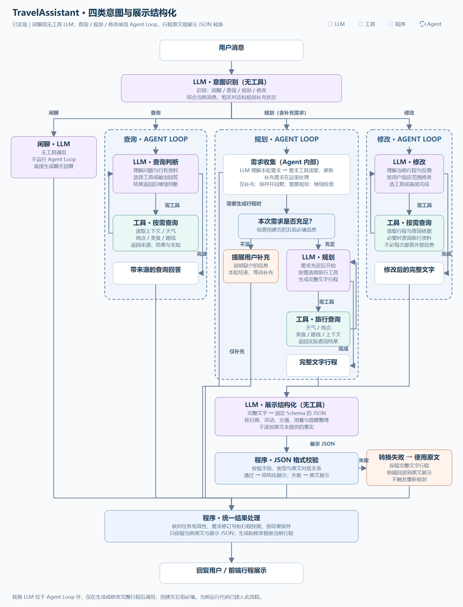
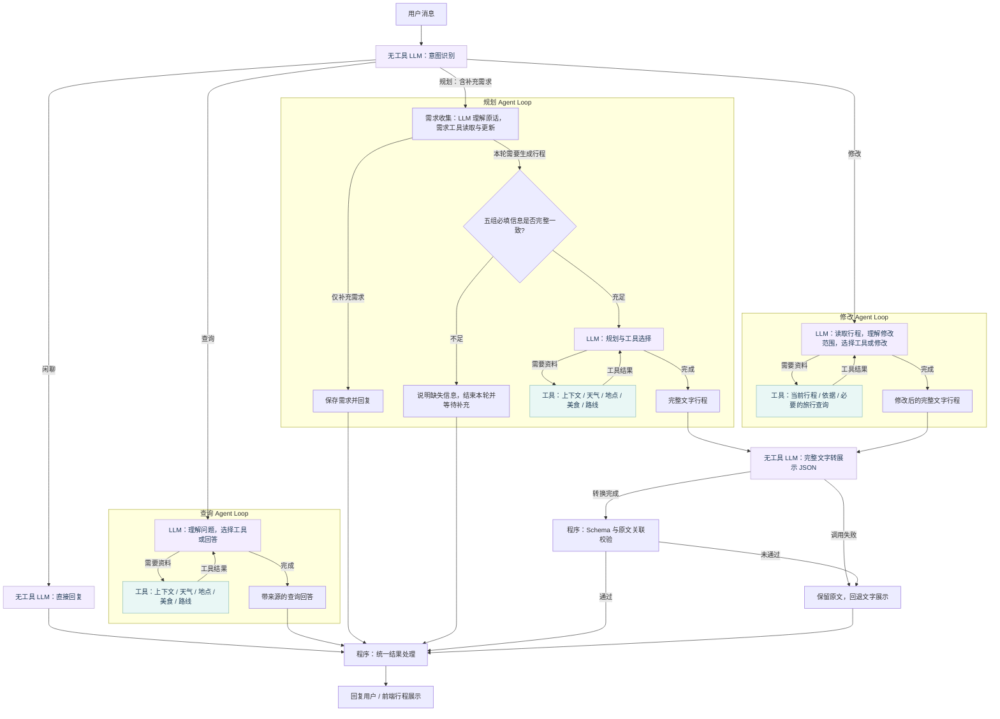

# TravelAssistant：四类意图、Agent Loop 与展示结构化

2026-10-10 已按此方案实施；当前执行、权限和限制见 [当前架构](agent-architecture-current.md)，验证见 [工作流验收](workflow-evaluation-20261010.md)。

先识别闲聊、查询、规划、修改四类意图，再进入对应业务路径。闲聊使用无工具 LLM；查询、规划、修改使用带工具的 Agent Loop。需求补充属于规划内部，不是第一层的独立意图，也不设置独立需求 Agent。规划与修改交付完整文字后，增加一个无工具 LLM 转换前端展示 JSON。此文记录框架与字段约定，运行代码已经接入。

[可放大的 SVG](travel-workflow-proposal.svg)

## 第一层与业务路径

| 部分 | 类型 | 职责 |
| --- | --- | --- |
| 意图识别 | 无工具 LLM | 结合最新消息、相关对话和当前规划的待补充状态，识别闲聊、查询、规划或修改 |
| 闲聊 | 无工具 LLM | 直接回复，不调用工具，不进入 Agent Loop |
| 查询 | 带工具的 Agent Loop | 理解问题、按需查询、根据结果继续判断，最后给出有来源的回答 |
| 规划 | 带工具的 Agent Loop | 收集与更新需求；需要生成时先检查信息，再按需查询并输出完整文字行程 |
| 修改 | 带工具的 Agent Loop | 根据当前行程和用户指定范围修改，必要时查询资料，返回完整修改稿 |
| 展示结构化 | 无工具 LLM | 接收完整文字原文，按固定 Schema 提取展示字段；不调用旅行工具，不重新规划 |
| JSON 校验 | 程序 | 检查字段、类型、结构和原文绑定，转换失败时回退原文展示 |
| 统一结果处理 | 程序 | 核对任务、需求修订号和行程快照，将原文及有效展示 JSON 一起保存到当前行程并回复 |

## 规划内部的需求补充

需求收集属于规划 Agent 的内部动作，使用规划 Agent 的 LLM 与需求读写工具，不增加独立需求 Agent 或单独的第一层需求路径。

需要生成行程时，先判断本次规划所需信息是否充足。不足则明确说明缺失信息、提醒用户补充并结束本轮；补充消息到达后重新识别意图，结合此前规划问题回到规划路径。需求未充足前不进入行程生成和为生成行程开展的外部查询。

仅补充需求时，保存有效需求并回复，不自动授权重排。若用户之前已要求生成，当前消息是在回答规划的补充问题，则可以承接原已授权的规划目标。例如：“生成行程”→“请补充预算”→“两人共1500，不含车票”，第三条仍进入规划。

创建行程页已确定只填写五组必填信息，规划 Agent 检查同一份有效需求：

| 必填组 | 填写内容 |
| --- | --- |
| 旅行城市 | 目的地城市 |
| 起止日期 | 开始日期、结束日期 |
| 抵离时间和地点 | 抵达时间、抵达地点、离开时间、离开地点；按旅行城市当地时间 |
| 旅行人数 | 总人数，正整数 |
| 预算金额和口径 | 金额、总预算/人均预算、包含的费用范围 |

创建时由程序检查必填和明显冲突，成功后保存为有效需求。偏好与限制在聊天中补充。已有记录缺字段或后续需求有冲突时，规划 Agent 提醒补齐；五组齐全后仍需判断预算及现实安排是否可行。

## LLM、Agent 与 Loop 的边界

紫色节点是 LLM 调用；绿色节点执行实际工具；深蓝虚线框分别表示查询、规划和修改 Agent Loop。每个 Agent Loop 都通过“LLM 判断 → 必要的工具执行 → 结果回传 → 继续或结束”完成业务。闲聊与第一层意图识别不属于这三条业务 Agent Loop。

三条业务路径复用同一套通用 Loop 实现，按业务配置目标、提示词和工具权限。不是每条路径都必须调用外部工具；查询、规划、修改模型可以在已有信息足够时直接完成。工具缓存、证据、耗时、预算及取消检查仍可使用现有实现。

规划与修改仍先交付完整文字。需求工具与最终保存程序校验候选变更，并保留旧轮作废、快照检查、失败保护能力；只保存当前行程。模型缺信息或执行失败时不保存新行程；已经产生的有效需求候选可单独保存。此处不设置独立查询准备模型；无工具 LLM 只用于意图识别、闲聊和下述展示转换。

## 完整文字之后的展示结构化

规划和修改输出完整文字后，共用一个无工具 LLM：完整文字原文 → 固定 Schema 的 JSON → 程序校验 → 前端展示。这个节点位于三条 Agent Loop 之外，只做展示转换，不调用工具、不重排日程、不核实新事实。普通查询回答、闲聊、需求补充和补充问题不进入转换节点。

建议保留完整文字原文，把 JSON 作为当前原文的展示数据；生成、修改时一起替换当前行程，确认只改变当前状态，不保存历史或提供恢复。转换失败或 JSON 未通过结构校验时，仍保留已生成的有效原文，前端回退文字展示，不重新触发规划。转换过程中被新消息替代时，沿用旧轮作废检查，不能回写原文或展示数据。

展示字段草案已整理为 [v1 字段说明](travel-itinerary-display-schema.md)、[JSON Schema](travel-itinerary-display-schema-v1.json) 与 [合成原文](travel-itinerary-display-example.txt) / [对应 JSON](travel-itinerary-display-example.json)，供讨论验收：

| 展示块 | 草案字段 |
| --- | --- |
| 行程概览 | title、overview、budget_note |
| 每天的安排 | days：date、label、theme、items |
| 活动卡片 | time_text、title、category、location、duration_text、description、cost_text、notes |
| 行前准备 | clothing、accommodation：title、body |
| 提醒与未知 | pending_items、risks |

活动、交通、用餐、住宿和休息统一使用卡片字段，通过 category 区分展示样式。所有键固定输出，未知文本为 null，空列表为 []。模糊时间保留原文，不补具体时刻。行程与可信工具标识由程序管理。

原文没有明确提供的信息保留为空或未知，不能补出具体时间、票价、酒店、坐标或预约状态。未知、估算和待核实措辞应进入相应展示字段，不能在转换时删除。POI、路线证据和行程标识由程序依据原始工具记录绑定，不能接受转换模型伪造的来源或标识。

JSON Schema 只能证明结构、字段和类型符合约定，不能自动证明转换内容与每句原文完全一致。结构化字段设计与后续验收应检查信息遗漏、未知状态丢失和事实新增；目前已接入转换及卡片展示，验收范围和限制见工作流报告。
